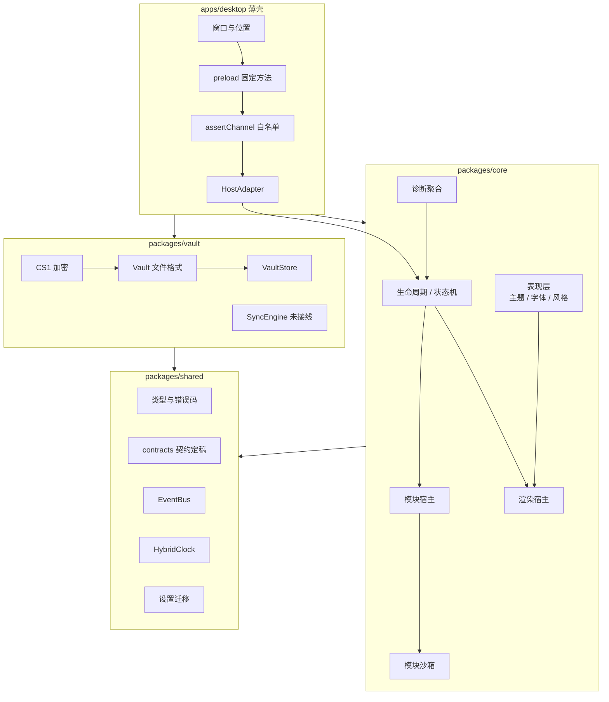
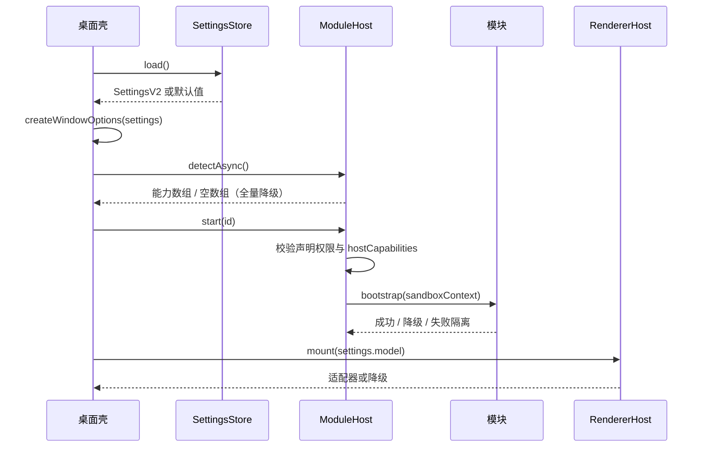
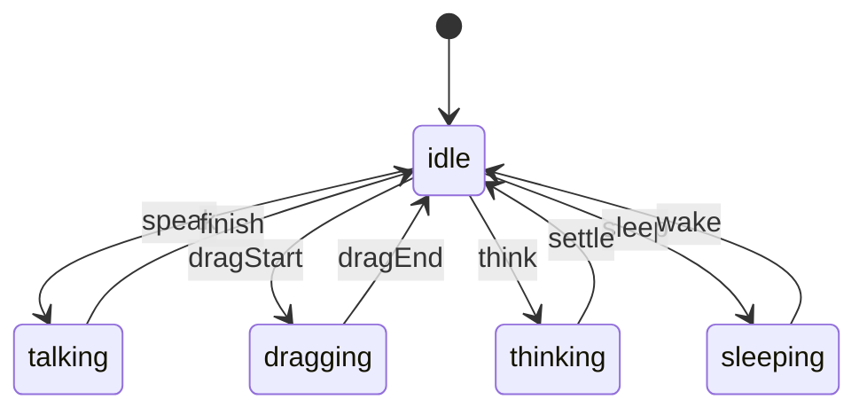
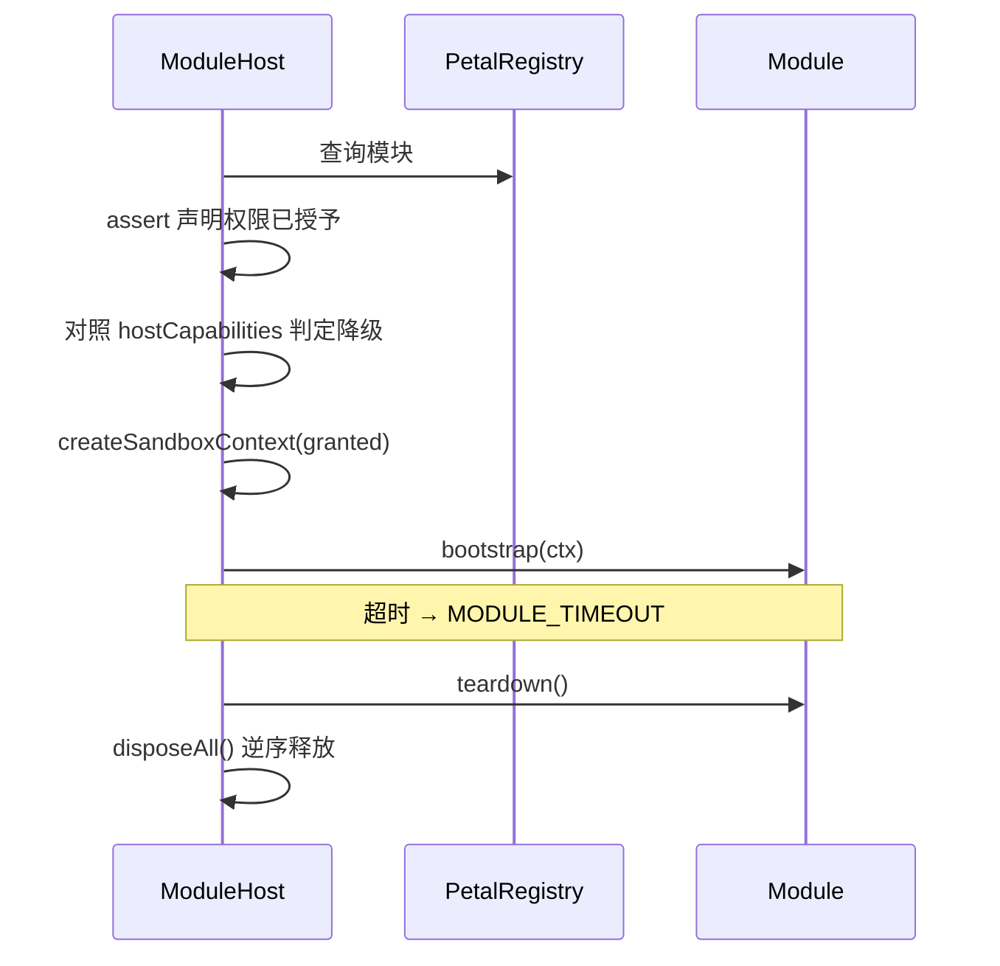

# 架构

> 历史版本：[2026-10-27](docs/archive/ARCHITECTURE-2026-10-27.md)｜归档规则见 [docs/archive/README.md](docs/archive/README.md)

## 分层



依赖只能向下：`shared ← core / vault ← apps`。`packages/core` 不导入 Electron，也不导入 `packages/vault`；桌面壳是唯一组合根。

## 包职责

| 包 | 职责 | 明确不做 |
| --- | --- | --- |
| `shared` | 类型、错误码、事件总线、HLC、设置迁移、`contracts/*` 契约 | 任何 I/O、计时器、平台 API |
| `core` | 宿主桥接、状态机、调度、模块宿主与沙箱、渲染宿主、表现层、诊断 | 加密、磁盘落盘、Electron |
| `vault` | 密钥派生与包裹、Vault 文件、口令备份、同步合并（已实现，桌面壳未接线） | UI、模块管理、宿主桥接 |
| `memory` | L1/L2 分层、摘要链、墓碑、衰减、token 预算 | 加解密、模块生命周期 |
| `ui` | 设置项注册表与渲染 | 业务逻辑、运行时装配 |
| `apps/desktop` | 窗口参数、IPC 白名单、preload、HostAdapter 接线 | 业务逻辑、渲染实现 |

## 端口层

`packages/shared/src/contracts/` 是唯一的契约来源，共 12 个文件：

```
channel.ts    crypto.ts     emotion.ts    font.ts
host.ts       memory.ts    presentation.ts  render.ts
settings.ts   style.ts     theme.ts      index.ts
```

契约只增不改：导出符号集合由 `scripts/contract-snapshot.mjs` 做快照，`verify` 时比对。少了任何一个符号就红，改签名也红。要演进就加新符号，旧的标 `@deprecated` 保留。

实现分散在各包里，`core` 只做装配：

| 契约 | 实现位置 |
| --- | --- |
| `host.ts` | `core/src/host/`：`IHostAdapter` / `LocalHostAdapter` |
| `render.ts` | `core/src/render/`：四类适配器、scaler、resourceLedger |
| `presentation.ts` / `theme` / `font` / `style` | `core/src/presentation/` |
| `memory.ts` | `packages/memory/` |
| `crypto.ts` | `packages/vault/` |
| `channel.ts` | `core/src/remote/` |
| `emotion.ts` | `core/src/emotion/` |

### 宿主能力矩阵

`HostCapability` 共 12 项，全部由宿主探测后逐项点亮：

```
ask  approval  taskProgress  settings  tray  window
llmCall  sessionRead  storage  fileAccess  voiceInput  skillCatalog
```

每项带一个宿主形态（`any` / `electron-only`）。`tray` 与 `window` 是 `electron-only`：纯插件形态下它们不是「缺失」，而是「不适用」，诊断里要分开报。

能力缺失不阻断加载，走 `CAPABILITY_DEGRADE` 登记的降级占位。降级、缺失、不适用是三种状态，不能混成一种。

能力名一律引用 `HOST_CAPABILITY` 常量，裸字符串会被扫描脚本拦下。

## 启动顺序



顺序上先读设置再开窗，窗口尺寸与置顶状态都来自同一份设置。模块启动失败只影响自己的运行状态，不阻断渲染与窗口。探测失败时传空数组，不乐观放行。

## 桌宠状态机



非法转移抛 `INVALID_ARGUMENT`，不会静默落到相邻状态。状态机不持有计时器，节拍由调用方驱动。

## 渲染

`RendererHost` 只依赖 `requestAnimationFrame` 与适配器注册表，帧间隔夹取到 `maxDelta`，无 rAF 时退回 16ms 定时器。

| 模型 kind | 适配器 | 前置条件 |
| --- | --- | --- |
| `image` | ImageAdapter | 无 |
| `gif` | GifAdapter | 无 |
| `video` | VideoAdapter | 无 |
| `live2d` | Live2DAdapter | 依次注入 Cubism Core → PIXI → pixi-live2d-display |
| `sprite` | 规划中（B2） | 帧序列 + 时序，2D 精灵动画 |

Live2D 加载失败时降级为静态图，不把错误抛到窗口层。未知 kind 抛 `MODEL_NOT_RENDERABLE`。

启动时若没有选中模型，主界面先用 `assets/whale-girl-stand` 的随包立绘，不把窗口留空；立绘也读不到时才停在空态引导卡。

## 2D 形象与两条通道

形象已定为 2D 精灵动画。`live2d` 适配器保留不删，`ModelKind` 目前只识别 image / gif / video / live2d，`sprite` 要等 B2 落地时补进契约。

这里有一条容易做错的分界：

| | 表现层通道（S7） | 动作通道（B2） |
| --- | --- | --- |
| 传什么 | 主题 / 字体 / 风格令牌 | 帧序列播放指令 |
| 频率 | 低频，换肤时一次 | 高频，每帧推进 |
| 语义 | 配置 | 事件 |
| 实例 | `presentation` 广播总线 | 独立的 Publisher/Subscriber |

不复用同一条总线。复用会让每帧一次的动作事件污染配置广播。形状可以同构：收发分离，子窗只拿 Subscriber。

动作通道的三条硬约束：

- 素材必须走 `assetRef` 校验，不另开加载路径
- 窗口不可见或失焦时降频或暂停，恢复后续播
- 命中测试先用矩形包围盒，透明边缘误触要写进已知问题

素材缺失时必须有可见提示。空画面不能用来表示失败状态。

## 模块生命周期



沙箱上下文按权限逐项挂载接口：未授予 `net.egress` 时 `ctx.api.net` 不存在。模块拿不到端口时得到 `NOT_SUPPORTED`，拿不到权限时启动阶段就被拒绝，声明了但宿主没有的能力则进入降级。

两种执行形态共用同一套沙箱契约：

| 形态 | 入口 | 适用 |
| --- | --- | --- |
| 主 realm | `createSandboxModuleLoader` | 随应用分发的可信内置模块 |
| Worker | `createWorkerModuleLoader` + `runModuleInWorker` | 第三方 / 不可信模块 |

主 realm 形态冻结 `config` / `granted` / `api` 与上下文，并在 bootstrap 期间按 `net.egress` 遮蔽全局网络接口。Worker 形态在此基础上让模块不再持有宿主端口与 DOM，所有能力调用经 `onApiCall` 回到宿主执行，`terminate` 可整线程回收。Worker 加载器目前由测试覆盖，桌面壳尚未接入。

`ModuleMeta` 的关键字段：

```ts
interface ModuleMeta {
  readonly id: string
  readonly name: string
  readonly version: string
  readonly permissions: readonly Permission[]
  readonly hostCapabilities?: readonly HostCapability[]
  readonly minHostVersion?: string
}
```

`permissions` 是用户授予的开关，`hostCapabilities` 是环境是否具备。前者缺了拒绝启动，后者缺了降级运行，两者不能混着判。

## 数据与同步

Vault 文件以 `DSHPET1` 开头，AAD 覆盖 magic、版本、套件、KDF 参数与 `updatedAt`。任何头部或密文改动都会在解密时变成 `VAULT_TAMPERED`。

日常数据由随机 AES-256 主密钥封装，主密钥只以 OS 后端包裹后的形式落盘。换机恢复走独立的口令备份（PBKDF2 + AES-GCM），细节见 [SECURITY.md](SECURITY.md)。

同步使用 HLC 做 LWW：

| 情况 | 结果 |
| --- | --- |
| 远端 HLC 更大 | 远端胜出，记录 `winner: remote` |
| 远端 HLC 更小 | 保留本地，记录 `winner: local` |
| 同 HLC 同值 | 视为重放，幂等跳过 |
| 同 HLC 不同值 | 保留本地，记录冲突 |
| 时间戳超出 `maxSkewMs` | 整批拒绝 `TIMESTAMP_EXPIRED` |

合并前先整批校验，避免部分写入。

`SyncEngine` 已接到本机目录：`fileSyncTransport` 把变更集写成 `<dir>/<node>/<hlc>.json`，托盘提供「导出同步包 / 应用对端变更」两个手动入口。仍然没有任何远端端点，也没有后台自动调度；跨机器要靠外部同步目录（`PET_SYNC_DIR`）自己搬。

## 当前装配状态

| 层 | 状态 | 说明 |
| --- | --- | --- |
| `assertChannel` + `registerChannel` | 已接线 | 注册期校验白名单，重复注册直接抛错 |
| `IpcRouter` 类 | 未使用 | 保留给其他宿主形态；桌面壳直接走 `ipcMain.handle` |
| `SyncEngine` | 已接线（本机目录） | 托盘手动导出 / 合并；无远端端点，无自动调度 |
| 聊天 / 余额 / 语音 / 记忆 | 硬编码 handler | 写在 `main.mjs`，不走模块沙箱 |
| `ModuleHost` / 模块沙箱 | 已实现 | 桌面壳当前没有加载任何第三方模块 |

这张表是判断「文档写的功能现在能不能用」的入口。新增接线时同步改这里，别只改上面的设计图。

## 同步包白名单

同步目录可能被 `PET_SYNC_DIR` 指到共享盘，写出去的内容等于离开本机。白名单只放「换机后仍有意义」的偏好项；密钥环、聊天历史、任务日志、记忆库、余额与本机路径一律不进。

清单以 `apps/desktop/electron/sync.mjs` 的 `SYNCABLE_SETTINGS_KEYS` 与 `REDACTED_SETTINGS_PATHS` 为唯一来源，`scripts/check-sync-manifest.mjs` 在 verify 链里守着三件事：白名单出现敏感键、剔除路径深度不足两层、剔除路径的根节点不在白名单内，任一条都直接判红。

## 语言双轨的分工

`packages/shared/src/contracts` 是通道、加密、设置等契约的唯一来源，类型先在这里定稿；`apps/desktop/src/main/ipc` 只做 TS 侧的装配与校验；`apps/desktop/electron/main.mjs` 是胶水层。

新通道只允许落在 `src/main/ipc`，`main.mjs` 不再新增业务函数。存量硬编码 handler 逐条迁出，台账以 `check-ipc-contract` 报告的未迁移 channel 数为唯一口径，迁移一条删一行，不再靠人口头记数。

## 目录

```
packages/shared/src
  contracts/    12 份契约：channel / crypto / emotion / font / host
                memory / presentation / render / settings / style / theme
  types/        设置、模块、模型契约
  events/       EventBus
  hlc.ts        混合逻辑时钟
  settings/     v1 → v2 迁移
packages/core/src
  host/         宿主桥接、IHostAdapter、能力探测
  state/        状态机
  schedule/     调度与退避
  modules/      清单、注册表、沙箱、宿主、内置模块
  render/       渲染宿主与适配器、resourceLedger
  presentation/ 广播总线、端口基座、白名单校验、主题 / 字体 / 风格
  assets/       资产校验、zip 守卫
  dialogue/     台词队列
  emotion/      本地情绪规则
  llm/          provider、降级链、TokenBucket
  diagnostics/  诊断聚合与面板
packages/vault/src
  crypto/       CryptoProvider 与 CS1
  file/         Vault 文件格式
  store/        加密仓库
  sync/         增量同步
apps/desktop/src
  ipc.ts        IPC 白名单与路由
  windowShell.ts 窗口参数与控制器
  preload.ts    固定方法桥
  hostAdapter.ts 能力降级
scripts/
  p0..p6-smoke.mjs      分阶段冒烟
  verify.mjs            全量门禁
  check-ipc-contract.mjs IPC 清单 / 主进程注册 / preload 一致性
  check-package.mjs     打包产物检查
  sanitize-check.mjs    敏感信息扫描
  history-scan.mjs      提交历史扫描
```
