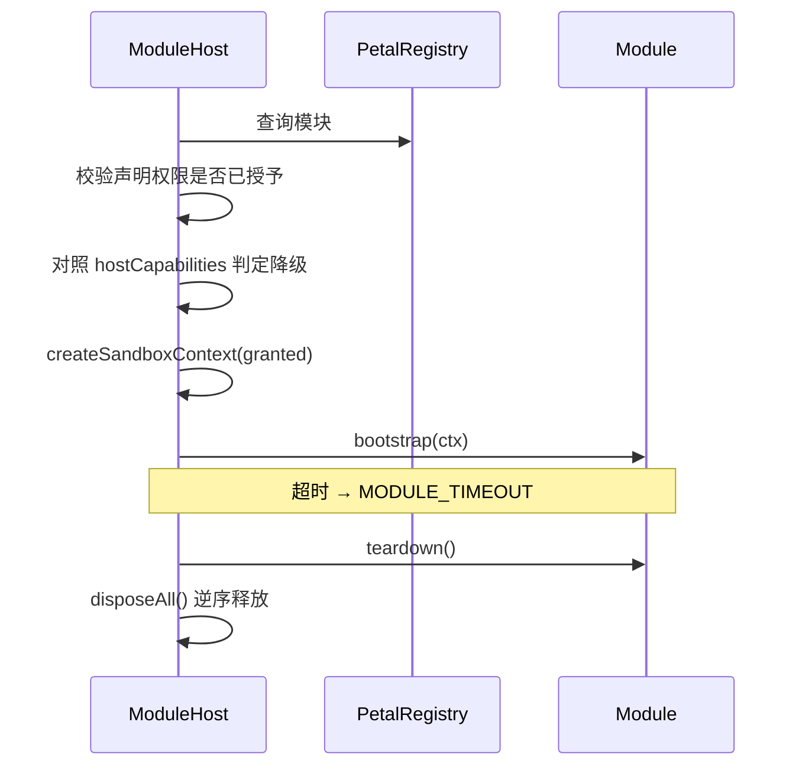

# 模块开发

> 历史版本：[2026-10-27](docs/archive/MODULE-AUTHORING-2026-10-27.md)｜归档规则见 [docs/archive/README.md](docs/archive/README.md)

## 目录结构

```
my-petal/
  petal.json      清单
  index.mjs       入口
```

## 清单

```json
{
  "id": "demo.hello",
  "name": "问候",
  "version": "1.0.0",
  "entry": "index.mjs",
  "permissions": ["ui.render"],
  "hostCapabilities": ["window"],
  "minHostVersion": "2.0.0"
}
```

| 字段 | 必填 | 规则 |
| --- | --- | --- |
| `id` | 是 | 小写字母或数字开头，只含 `a-z0-9._-`，2–64 位 |
| `name` | 是 | 去空格后 1–64 字符 |
| `version` | 是 | semver，如 `1.2.3` 或 `1.2.3-beta.1` |
| `entry` | 是 | 模块根目录内的相对路径，只允许 `.js` / `.mjs`，禁止 `..` |
| `permissions` | 是 | 字符串数组，必须在权限白名单内；重复项自动去重 |
| `hostCapabilities` | 否 | 依赖的宿主能力；任一项缺失即降级，不填表示无要求 |
| `minHostVersion` | 否 | semver，宿主低于此版本时降级 |

未知字段会被忽略，便于旧宿主读取新清单。清单不合法时返回 `MODULE_LOAD_FAILED`。

`permissions` 和 `hostCapabilities` 是两回事，混着写会遇到很难查的问题：

| | `permissions` | `hostCapabilities` |
| --- | --- | --- |
| 含义 | 用户是否授予这个能力 | 环境是否具备这个能力 |
| 缺了怎样 | 启动阶段直接拒绝 | 降级运行，不阻断加载 |
| 谁决定 | 用户 | 宿主探测 |

用户没授予 `net.egress`，模块不该启动；宿主没有 `window`，模块还能以无窗口形态活着。两种缺失给两种结果。

## 权限

`Permission` 共 10 项，全部默认关闭，用户逐项开启：

| 权限 | 暴露的接口 | 典型用途 |
| --- | --- | --- |
| `ui.render` | `ctx.api.ui.render(html)` | 气泡、一次性渲染 |
| `ui.panel` | `ctx.api.ui.panel.register(spec)` | 侧边栏面板 |
| `ui.click-through` | 窗口点击穿透控制 | 全屏透明层 |
| `net.egress` | `ctx.api.net.fetch(url, init)` | 余额查询、远端请求 |
| `fs.user-assets.read` | `ctx.api.fs.readAsset(path)` | 读取用户素材 |
| `dsh.context.read` | 宿主上下文读取端口 | 读取当前会话语境 |
| `dsh.decision.commit` | 宿主决策接口 | 提交需要用户确认的操作 |
| `vault.seal` | 加密封装端口 | 写入需要密封的数据 |
| `memory.read` | `ctx.api.memory.read(key)` | 读取记忆 |
| `memory.write` | `ctx.api.memory.write(key, value)` | 写入记忆 |

`ui.render` 与 `ui.panel` 分开授权：前者是一次性画出内容，后者是常驻侧边栏的长期位置，
风险不同，用户应该能只给其中一个。

没有授予的权限不会出现在 `ctx.api` 上。属性本身不存在，类型断言也绕不过去。声明了但宿主未授予时，启动阶段直接失败并返回 `PERMISSION_DENIED`。

## 宿主能力

`HostCapability` 共 12 项：

```
ask  approval  taskProgress  settings  tray  window
llmCall  sessionRead  storage  fileAccess  voiceInput  skillCatalog
```

其中 `tray` 与 `window` 是 `electron-only`。在纯插件形态下它们属于「不适用」，不属于「缺失」，诊断输出要分开报。

能力名一律引用 `HOST_CAPABILITY` 常量。裸写字符串会被扫描脚本拦下，因为 `approval` 在加密契约里也是合法字面量，裸写之后读代码的人分不清来源。

## 模块实现

```ts
import type { IPetalModule } from '@pet/shared'
import type { SandboxModuleContext } from '@pet/core'

export const helloModule: IPetalModule = {
  meta: {
    id: 'demo.hello',
    name: '问候',
    version: '1.0.0',
    permissions: ['ui.render'],
    hostCapabilities: ['window']
  },
  async bootstrap(ctx) {
    const sandbox = ctx as SandboxModuleContext
    if (sandbox.api.ui === undefined) {
      throw new Error('缺少 ui.render')
    }
    sandbox.api.ui.render('<div class="hello">你好</div>')
  },
  async teardown() {
    // 释放自己创建的资源
  },
  async diagnose() {
    return { ok: true }
  }
}
```

`teardown` 应保持幂等。宿主在停止模块时会先调用它，再逆序执行 `ctx.disposers` 中登记的清理函数。

`diagnose` 可选，用来回答「这个模块现在还好吗」。它不该触发网络请求或写入，只读自身状态。

## 生命周期



1. 宿主查注册表并确认模块存在
2. 校验声明权限是否全部已授予
3. 对照宿主能力，判定是否需要降级
4. 按已授予权限构建沙箱上下文
5. 在超时限制内执行 `bootstrap`
6. 停止时执行 `teardown`，再 `disposeAll`

单次 `bootstrap` / `teardown` 超时返回 `MODULE_TIMEOUT`，失败只影响当前模块，其他模块继续运行。

## 素材与动作

模块可以读用户素材，但不能自己开文件路径：

- 读素材走 `ctx.api.fs.readAsset(path)`，路径守卫与格式校验都在宿主侧
- 2D 动作帧序列以 `assetRef` 引用，不内联 base64，也不在模块里拼绝对路径
- 第三方立绘、音频不进仓库；模块只能引用用户素材层里的文件

素材缺失时给可见提示。空画面不能拿来表示失败。

模块要播动作时，走动作通道（B2 落地后开放），不要复用表现层的主题广播。那条总线传的是低频配置，塞进每帧指令会让换肤逻辑与播放逻辑互相干扰。

## 错误处理

| 情况 | 错误码 |
| --- | --- |
| 模块不存在 | `NOT_FOUND` |
| 清单非法 | `MODULE_LOAD_FAILED` |
| 权限未授予 | `PERMISSION_DENIED` |
| 超时 | `MODULE_TIMEOUT` |
| 宿主能力缺失 | 降级占位，不抛错 |
| 宿主端口不存在 | `NOT_SUPPORTED` |
| 素材格式不合法 | `ASSET_INVALID_MAGIC` |
| 素材含可执行或可注入类型 | `ASSET_FORBIDDEN_TYPE` |

抛出的异常由宿主转成 `PetError`，模块不需要自己拼接错误对象。

## 测试建议

- 直接构造 `createSandboxContext`，传入假 `root` 与假端口，验证权限裁剪与调用参数
- 用 `ModuleHost` + `PermissionBroker` 跑四条路径：有权限、无权限、宿主能力缺失、超时
- 单独验一次 `hostCapabilities` 缺项：模块应降级启动，不该被拒绝
- 不要把网络请求写进 `bootstrap` 的同步段，异步失败要能被宿主捕获

内置模块可以作为最小参考：

- `packages/core/src/modules/builtin/bubble.ts`：只渲染
- `packages/core/src/modules/builtin/balance.ts`：只联网
- `packages/core/src/modules/builtin/reminder.ts`：记忆读写
