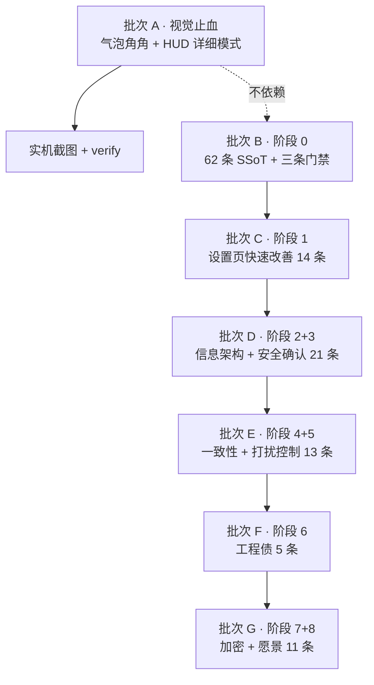

# 62 条验收意见整合推进计划

> 依据：`agent-desktop-pet-项目推进表.md`（62 条）、`agent-desktop-pet-第三方验收意见-未完成清单.txt`（52 条）、`agent-desktop-pet-第三方验收意见.txt`（53–62）
> 基线：`b532246`（已推送，`pnpm verify` EXIT=0 / `P6_GATE_OK`）
> 裁定：柒柒 2026-11-01 —— 本轮做 A + B；阶段 7、8 都要做并排入后续批次；不做工期估算，按批次顺序推进。

---

## 一、现状事实

| 项 | 事实 | 证据 |
| --- | --- | --- |
| 基线提交 | `b532246`，已推到 `bestlike093/agent-desktop-pet` main | `git log --oneline -1`；`f5ffa2e..b532246` |
| 未提交改动 | 仅 `renderer/renderer.mjs`（+113/−55），上一轮被中断的半成品 | `git status --porcelain` |
| 气泡角角 | 已换成参考库单层水滴，旧两层 clip-path 三角已删 | 未提交 diff，`--tail-w/h/drop` |
| 气泡偏移真因 | 旧版 `.pet-bubble.show` 的 `translate(-50%)` 盖掉 wrap 内层，把内层推出半个身位 | 未提交 diff 注释与选择器提权 |
| HUD 逻辑层 | `.expanded` 切换、`syncHudExpanded()`、档位变更才复位展开态 | 已改 |
| HUD 结构层 | **未做**：`renderHud()` 仍是老结构，CSS 仍走 `conic-gradient` | `renderer.mjs:1314`、`styles.css:356` |
| 阶段 0 | **未做**：`docs/` 无 SSoT；`scripts/` 无 i18n / 写死色值 / 单图体积三条门禁 | 目录列举 |
| 路径勘误 | 设置页真实路径是 `apps/desktop/electron/renderer/settings.html`，验收意见省略了 `renderer/` 一层 | 目录列举 |

---

## 二、批次划分

| 批次 | 条目 | 出口标准 |
| --- | --- | --- |
| A | 用户点名项（气泡 / HUD） | 截图可见角角朝下对齐立绘；五档切换正常；`pnpm verify` 绿 |
| B | 0.1、0.2 | `docs/SSOT.md` 62 条全有结论与证据；三条门禁跑出基线数字 |
| C | 9–14、22、23、27、28、30–33 | 高频操作零翻页；切「天青」后子窗跟随 |
| D | 1–8、15–21、39–44 | 九面板收四组；不可逆操作全部二次确认 |
| E | 24–26、29、34–38、45–48 | i18n 门禁绿；无裸 hex；夜间不扰 |
| F | 49–52、54 | verify 含三条新门禁；发布包干净 |
| G | 53、55–62 | 每项有对应测试或脚本；不做项显式标注 |

---

## 三、批次 A 任务清单

- [ ] A1 `renderHud()` 改为 `.hud-head` + `.hud-detail` 两段式
- [ ] A2 三环由 `conic-gradient` 换成 SVG `circle`，周长 100.53 驱动 dasharray / dashoffset
- [ ] A3 `styles.css` 对齐参考库 HUD，清掉末尾冲突的 `#hud` border / box-shadow 覆盖
- [ ] A4 五档语义对齐：`off / compact / simple / simple2 / full`，老配置 `compact` 继续认
- [ ] A5 数据缺失保持灰化 + `—`，不填假 0；余额在 balance 关闭时如实不显示
- [ ] A6 实机 CDP 截图：角角朝向、气泡不压立绘、HUD 不遮字
- [ ] A7 `pnpm verify` EXIT=0 且 `P6_GATE_OK`，提交并推送

## 四、批次 B 任务清单

- [ ] B1 62 条逐条核对，标 ✓已落地 / △待做 / ✗过时，附文件与行号证据
- [ ] B2 产出 `docs/SSOT.md`，作为后续唯一事实源
- [ ] B3 `scripts/check-i18n-coverage.mjs`：扫描 renderer 下 HTML 未被 `data-i18n` 覆盖的中文
- [ ] B4 `scripts/check-hex-colors.mjs`：扫描过期写死色值（先出基线，再决定是否硬失败）
- [ ] B5 `scripts/check-image-size.mjs`：单图 > 512KB 列出清单
- [ ] B6 三条门禁接入 `verify`，跑出并记录基线数字

---

## 五、约束

1. `models.mjs` 零改动。
2. 不做假开关、假状态、假数据；拿不到就 `—` 或如实隐藏。
3. 密钥一律掩码，日志与测试快照不得出现明文。
4. 遵守 CSP：无外链资源、无 `eval`、无内联事件属性。
5. 禁止 `git add -A`；提交信息写明验证结果。
6. 设置页重组只动 nav 与 panel 容器，不动 item 的 DOM id 与设置字段。
7. 不可逆操作（自动备份、密钥轮换）执行前单独确认。
